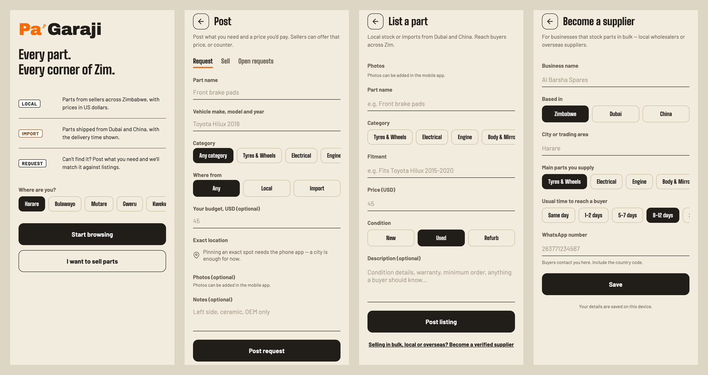
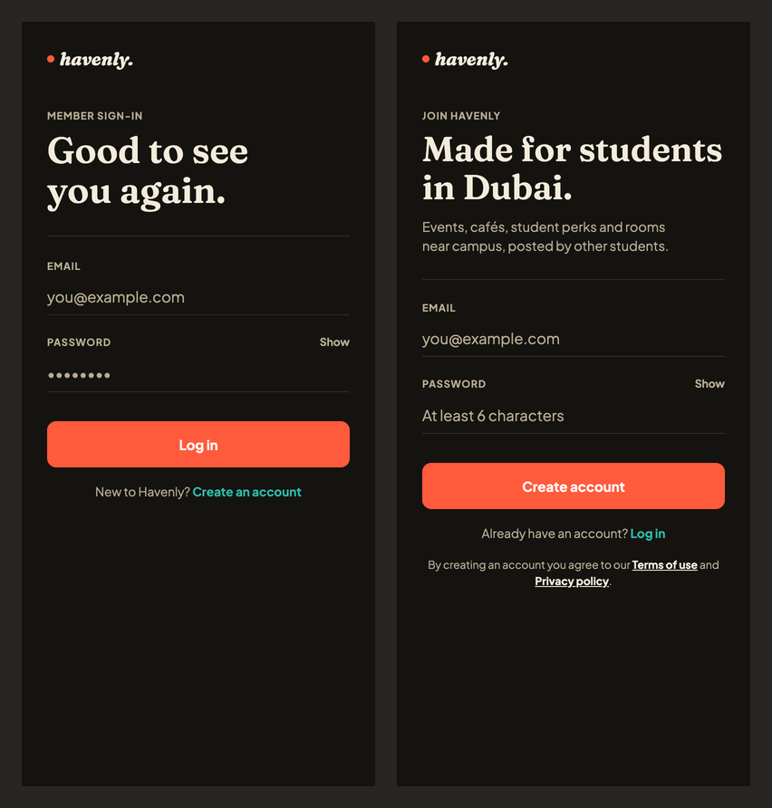

# Tadiwanashe Chirambamhanda

**AI automation and full-stack developer, Dubai.** I build WhatsApp AI agents and mobile and web apps where the code makes the decisions and the AI only writes the words. Every project below has a written brief, acceptance criteria, automated tests and an independent review.

> Finance undergraduate (Murdoch University Dubai) with inventory, marketing-research and sales experience. Open to junior AI engineer, agentic AI developer, AI automation and full-stack roles in the UAE. Completing the AI for Software Development and Agentic AI Solutions programmes at Saqr Academy, Dubai (ends 28 Nov 2026).

## Featured projects

| Project | What it is | Proof |
|---|---|---|
| [**Smile Book**](projects/smile-book.md) | Bilingual (English/Arabic) WhatsApp reminder agent for a Dubai dental clinic | **193 passing tests**, 14 features, 3 rounds of independent review |
| [**Future Academy Desk**](projects/future-academy-desk.md) | WhatsApp enquiry agent that answers in English, Shona and Ndebele | **134 passing tests**, 30/30 end-to-end runs pass, about **$0.0055 per AI reply** |
| [**Liwan Desk**](projects/liwan-desk.md) | WhatsApp front-desk agent for a Dubai dental clinic, with hand-over to staff | Live on Vercel, signed webhooks and rate limits |
| [**Havenly**](projects/havenly.md) | Student community and housing app for Dubai (iOS and Android) | **162 commits**, about 13,900 lines of TypeScript, **122 row-level security policies** |
| [**Tuitionless**](projects/tuitionless.md) | Scholarship matcher for students from any country | **169 scholarships**, 9 countries, built by 3 parallel lanes, live |

Also built: [**PaGaraji**](projects/pagaraji.md), a Zimbabwe spare-parts marketplace app (Expo, Supabase, 26 database migrations, live bidding) with its own waitlist site.

## Mobile apps

## How I build

- **Code decides, AI proposes.** Rules live in plain, tested code. The model reads the message and writes a warm sentence; code checks every reply before it is sent. Anything unsure goes to a person.
- **Brief, plan, build, review.** Each feature starts with a PRD and checkable acceptance criteria, then a plan, then small commits, then an independent review by a second AI model.
- **Safety by default.** Prompt-injection tests, signed webhooks, rate limits, locked database tables, secrets kept on the server, synthetic data only.
- **Measured cost.** Every AI call logs its latency and cost.

## Code

[braces-reminders](https://github.com/tadiwachirambamhanda-cyber/braces-reminders) · [future-academy-desk](https://github.com/tadiwachirambamhanda-cyber/future-academy-desk) · [liwan-desk](https://github.com/tadiwachirambamhanda-cyber/liwan-desk) · [havenly](https://github.com/tadiwachirambamhanda-cyber/havenly) · [tuitionless](https://github.com/tadiwachirambamhanda-cyber/tuitionless) · [PaGaraji](https://github.com/tadiwachirambamhanda-cyber/PaGaraji)

## Skills and tools

- **AI and agents:** Claude API (Anthropic SDK), **Jev classifier (TypeSafe AI SDK)**, agent design, LLM guardrails, prompt-injection defence, classification with confidence thresholds, reply validation, human hand-over, evaluation harnesses, AI cost and latency tracking.
- **AI-assisted development:** Claude Code (custom skills such as /brief, /plan, /build, /codex-review and /pr, hooks, subagent reviewers), OpenAI Codex as an independent code reviewer, written briefs, plans and acceptance criteria.
- **MCP connectors:** Supabase, Vercel, Figma, Canva, Adobe Express, Google Drive and Sheets, Claude in Chrome (browser automation), iOS Simulator.
- **Front end and mobile:** TypeScript, React 19, Next.js 16 (App Router), Tailwind CSS, React Native, Expo, Expo Router, React Navigation, Reanimated, Mapbox, react-native-maps.
- **Back end and data:** Supabase (PostgreSQL, Auth, Storage, Realtime, row-level security, migrations, database functions), SQL, Node.js, REST, webhooks, Zod, WhatsApp Business API (360dialog).
- **Quality and delivery:** Vitest, ESLint, GitHub Actions CI, Git and pull requests, Vercel (serverless, regions, cron), Sentry, independent code review.

## Contact

[LinkedIn: linkedin.com/in/tadiwa-chirambamhanda](https://www.linkedin.com/in/tadiwa-chirambamhanda)
