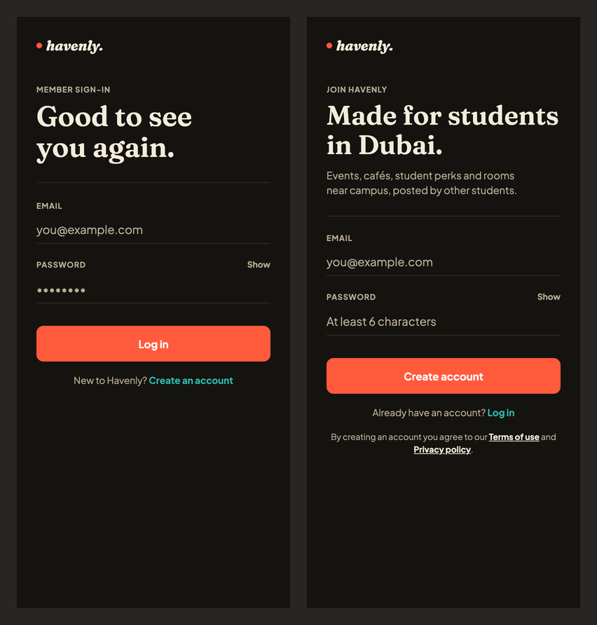

# Havenly: student community and housing app for Dubai

**Repo:** https://github.com/tadiwachirambamhanda-cyber/havenly · **Stack:** React Native, Expo, TypeScript, Supabase (Postgres, Auth, Storage, Realtime), React Navigation, Vercel (web)

*Sign-in and sign-up screens from the web build running locally. The signed-in app (feed, communities, messages, housing) holds real members' content, so it is not shown here.*

## What it is
A visual-first community app for students and young adults in Dubai: a card feed with editorial picks, Discover (spots and events), interest and campus communities, real-time direct messages, profiles, and a student housing section with listings, enquiries and a referral-fee pipeline.

## What I built
- iOS and Android from one codebase, plus a web build deployed on Vercel.
- **Supabase back end: 58 migrations, 28 tables, 122 row-level security policies**, real-time chat, account deletion that removes chat traces and uploads, block and report tables.
- Safety and trust: an adversarial review that closed five security and data-safety holes, mutual-follow rule for group invites, draft privacy policy and terms, crash reporting, error screen.
- Design and UX: Phosphor icon set, dark mode, skeleton loaders, UX-law fixes (Fitts, Doherty, Miller, Jakob), admin notifications for housing enquiries.

## Numbers
**162 commits** over 2 months, about **13,900 lines of TypeScript**, 60 SQL files, CI checks, launch PRD and technical requirements documents.

## Skills shown
Mobile development, relational schema design, row-level security, real-time features, product thinking for the UAE student market.
