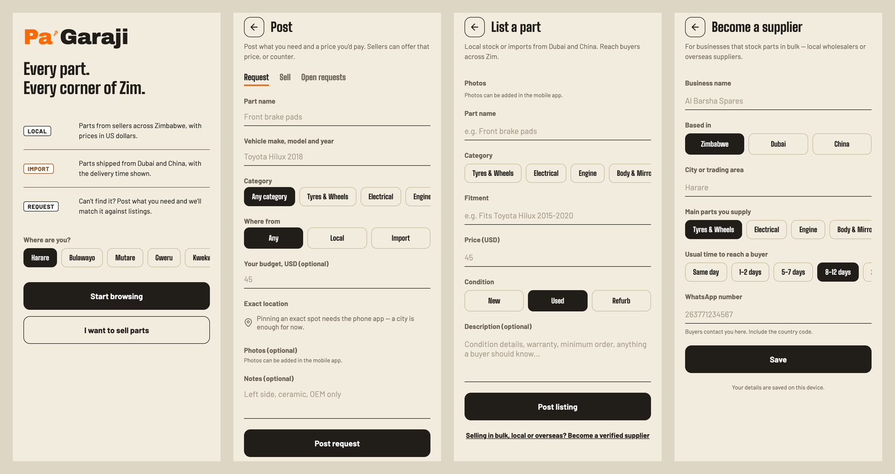

# PaGaraji: spare-parts marketplace for Zimbabwe

**Repo:** https://github.com/tadiwachirambamhanda-cyber/PaGaraji · **Landing page:** https://github.com/tadiwachirambamhanda-cyber/pagaraji-landing · **Stack:** Expo SDK 57, React Native, expo-router, TypeScript, Supabase (Postgres, Auth, Storage, Realtime), Next.js (landing)

*Screens from the web build running locally: welcome, post a request, list a part, become a supplier. Signed-in screens (live bids, chat, map) need a phone and real accounts, so they are not shown here.*

## What it is
A mobile marketplace where drivers find spare parts and sellers compete to supply them: listings, parts requests with live bidding, real-time chat, map and live location sharing, seller ratings and verified-supplier tags.

## What I built
- Buyer and seller flows: listings with photos, requests, offers and counter-offers with live-updating bids, Deals and Selling tabs, a "needs a response" badge.
- Supabase back end with **26 migrations**, row-level security and signed photo URLs; real-time chat and presence.
- Trust and safety: manual supplier-verification checklist, ratings, verified tags.
- A Next.js waitlist page whose form writes to Supabase through a server action, with row-level security so nobody can read the list through the API.

## Numbers
18 commits, about 12,700 lines of TypeScript, built in two weeks (Sep to Oct 2026).
